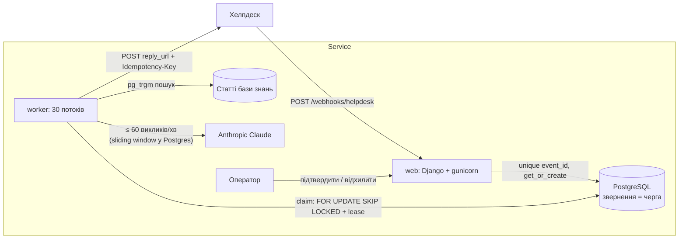

# Support Drafts — чернетки відповідей підтримки з LLM

Сервіс приймає нові звернення з хелпдеску, знаходить релевантні статті бази знань, генерує LLM-чернетку відповіді з посиланнями на них, дає оператору підтвердити (з правками) або відхилити її і надсилає підтверджену відповідь клієнту через API хелпдеску — рівно один раз.

Продукт у базі знань вигаданий: **«Звітник»**, SaaS для звітів і дашбордів.

## Розгорнутий сервіс

| Що | Посилання |
| --- | --- |
| Інтерфейс оператора | _буде додано після деплою_ |
| Вебхук | _буде додано після деплою_ |
| Мок хелпдеску (що отримали клієнти) | _буде додано після деплою_ |
| База знань | _буде додано після деплою_ |

Демо-логін оператора: `operator` / пароль — у змінній `OPERATOR_PASSWORD` (локально `operator`).

## Як це працює



Життєвий цикл звернення:

```text
new → drafting → draft_ready → approved → sending → sent
         ↓             ↓                      ↓
   draft_failed     rejected             send_failed      (оператор може «Повторити» з *_failed)
```

1. **Отримання.** Вебхук валідує тіло, вставляє звернення з унікальним `event_id` і одразу відповідає `200` (`accepted` або `duplicate`). Більше нічого в запиті не відбувається, тому відповідь займає десятки мілісекунд. Дублікати, зокрема одночасні, відсікає унікальний індекс.
2. **Генерація.** Окремий процес-воркер бере звернення з черги в Postgres. Пошук статей іде через `pg_trgm`, бо для української в Postgres немає стемера, а триграми знаходять «експортувати» за словом «Експорт». Далі воркер чекає слот глобального rate limit і викликає LLM.
3. **Модерація.** Оператор бачить список звернень і чернетку зі знайденими статтями. Він може відредагувати текст, підтвердити або відхилити.
4. **Надсилання.** Воркер надсилає відповідь на `reply_url` з заголовком `Idempotency-Key`, який однаковий для всіх спроб. Якщо хелпдеск відповів `5xx` або не відповів вчасно, спроба повторюється з backoff.

## Як виконано вимоги

| Вимога | Рішення |
| --- | --- |
| Вебхук відповідає за ≤ 2 с | Вебхук лише зберігає звернення. Під навантаженням 500 подій з дублями: p95 = 0.14 с, max = 0.55 с. |
| Повтори й дублікати, зокрема одночасні | `event_id` унікальний, вставка через `get_or_create` (race-safe). Дубль отримує `200 {"status": "duplicate"}`. Тест: 16 одночасних доставок створюють одне звернення. |
| До 500 звернень за 10 хв, нічого не втрачаємо | Звернення комітиться до відповіді `200`. Черга живе в Postgres ([ADR-0001](docs/adr/0001-postgres-is-the-job-queue.md)). Якщо воркер впав, lease спливає (5 хв), і звернення бере інший воркер. |
| LLM 5–30 с, 60 запитів на хвилину на весь сервіс | 30 потоків воркера. Ліміт — sliding window у Postgres з advisory lock, тож він спільний для всіх потоків і реплік ([ADR-0003](docs/adr/0003-global-llm-rate-limit-in-postgres.md)). SDK-ретраї вимкнено, повтори йдуть через чергу. |
| Режим без API-ключа | Реальний запит до Anthropic таки йде (з фіктивним ключем, отримуємо 401). Потім підставляється статична чернетка з посиланнями на знайдені статті, а загальна тривалість виклику — випадкова, 5–30 с. Ліміт діє так само. |
| Хелпдеск повертає 5xx або не відповідає вчасно | Ретраї з backoff 10 с → 10 хв, до 8 спроб, далі `send_failed` і кнопка «Повторити». `4xx` не ретраїться. |
| Клієнт не отримує ту саму відповідь двічі | `Idempotency-Key` для кожного звернення, однаковий у всіх спробах; хелпдеск дедуплікує. Підтвердження — умовний `UPDATE` з `draft_ready`, тож подвійний клік чи два оператори дають одну відповідь ([ADR-0002](docs/adr/0002-exactly-once-reply-via-idempotency-key.md)). |
| `/health` → `200 OK` | Так. |

> **Припущення:** реальний хелпдеск має підтримувати `Idempotency-Key`. Без дедуплікації на боці отримувача exactly-once неможливий: після таймауту ми не знаємо, чи збережено відповідь. Мок хелпдеску цей заголовок підтримує.

## Локальний запуск

Потрібен Docker з Compose v2.

```bash
cp .env.example .env        # необов'язково; без ANTHROPIC_API_KEY сервіс працює в демо-режимі
docker compose up --build
```

Буде піднято:

- `db` — PostgreSQL 17 (порт 5432);
- `web` — застосунок на http://localhost:8000. Під час старту він накатує міграції (зокрема засіває 8 статей) і створює демо-оператора;
- `worker` — фоновий обробник: 30 потоків, генерує чернетки й надсилає відповіді.

| Сторінка | URL |
| --- | --- |
| Інтерфейс оператора | http://localhost:8000/tickets/ (логін `operator` / `operator`) |
| База знань і пошук | http://localhost:8000/kb/ |
| Мок хелпдеску: що отримали клієнти | http://localhost:8000/mock-helpdesk/ |
| Health | http://localhost:8000/health |

### Надіслати одне звернення

```bash
curl -X POST http://localhost:8000/webhooks/helpdesk \
  -H 'Content-Type: application/json' \
  -d '{
    "event_id": "evt_8f2a",
    "ticket_id": "T-1042",
    "customer_email": "user@example.com",
    "message": "Не можу експортувати звіт у PDF",
    "reply_url": "http://web:8000/mock-helpdesk/tickets/T-1042/replies"
  }'
# {"status": "accepted"}; повторний запит → {"status": "duplicate"}
```

`reply_url` вказує на мок хелпдеску за адресою, яку бачить воркер усередині compose (`web:8000`). Приблизно за 5–30 с у `/tickets/` з'явиться чернетка. Після підтвердження відповідь потрапить на `/mock-helpdesk/`.

### Симуляція піку

```bash
docker compose exec web python manage.py simulate_webhooks --count 500 --duplicate-rate 0.3 --concurrency 20
# --over-seconds 600   розподілити 500 подій на 10 хвилин, як у реальному піку
```

Симулятор надсилає події з повторами (одночасно) і друкує звіт:

```text
requests sent:            760
accepted (new Tickets):   500
acknowledged duplicates:  260
errors:                   0
webhook latency, s:       p50 0.039  p95 0.144  max 0.547
```

Щоб подивитися на rate limit, стежте за логами: `docker compose logs -f worker`.

### Змінні середовища

| Змінна | За замовчуванням | Що робить |
| --- | --- | --- |
| `ANTHROPIC_API_KEY` | _порожньо_ | Порожній ключ вмикає демо-режим LLM |
| `LLM_MODEL` | `claude-sonnet-5-5` | Модель Claude |
| `LLM_RATE_LIMIT_PER_MINUTE` | `60` | Глобальний ліміт викликів LLM |
| `LLM_TIMEOUT_SECONDS` | `60` | Таймаут виклику LLM |
| `WORKER_THREADS` | `30` | Потоки воркера |
| `HELPDESK_TIMEOUT_SECONDS` | `10` | Таймаут надсилання відповіді |
| `OPERATOR_USERNAME` / `OPERATOR_PASSWORD` | `operator` / `operator` | Демо-оператор, створюється під час старту `web` |
| `PUBLIC_BASE_URL` | `http://localhost:8000` | Основа для абсолютних посилань на статті в чернетках |
| `SIMULATOR_REPLY_BASE_URL` | `PUBLIC_BASE_URL` | Куди симулятор просить хелпдеск доставляти відповіді (адреса мока для воркера) |
| `MOCK_HELPDESK_FAILURE_RATE` | `0.2` | Частка відповідей мока `503` |
| `MOCK_HELPDESK_SLOW_RATE` | `0.1` | Частка «повільних» відповідей: мок зберігає відповідь, але відповідає пізніше за наш таймаут |
| `MOCK_HELPDESK_SLOW_SECONDS` | `15` | Наскільки пізно |
| `DATABASE_URL` | compose Postgres | Рядок підключення |
| `SECRET_KEY` | — | Обов'язкова. Без неї сервіс не стартує, якщо не задано `DEBUG=1`. У compose задано dev-значення |
| `DEBUG`, `ALLOWED_HOSTS`, `CSRF_TRUSTED_ORIGINS` | — | Стандартні налаштування Django |

## Тести

Тести ходять у справжній PostgreSQL, бо перевіряють `ON CONFLICT`, `SKIP LOCKED`, advisory locks і `pg_trgm`.

```bash
docker compose up -d db
python -m venv .venv && .venv/bin/pip install -r requirements/dev.txt
.venv/bin/pytest            # налаштування: config/test_settings.py
```

Або в контейнері: `docker compose run --rm web pytest`.

Тести перевіряють поведінку на чотирьох межах:
1. HTTP: вебхук, сторінки оператора, мок хелпдеску.
2. Один крок воркера `Worker.run_once()` з фейковим годинником.
3. Адаптери LLM і хелпдеску з підробленим HTTP-транспортом.
4. Глобальний rate limiter LLM (`try_acquire()`): його гарантію для кількох реплік не видно через один крок воркера.

Серед них є конкурентні тести на реальних потоках: одночасні дублі вебхука, кілька воркерів, кілька операторів, rate limit.

## Деплой на Railway

Образ один, сервіси два: `web` і `worker`. Конфіги лежать у `railway/web.json` і `railway/worker.json`.

1. Створіть проєкт на Railway і додайте **PostgreSQL**.
2. Додайте сервіс з цього GitHub-репозиторію з назвою `web`. У Settings → Config-as-code вкажіть `railway/web.json` і згенеруйте публічний домен.
3. Додайте ще один сервіс з того ж репозиторію з назвою `worker` і конфігом `railway/worker.json`.
4. Змінні для обох сервісів:
   ```
   DATABASE_URL=${{Postgres.DATABASE_URL}}
   SECRET_KEY=<випадковий рядок>
   PUBLIC_BASE_URL=https://<домен web>
   SIMULATOR_REPLY_BASE_URL=https://<домен web>
   ANTHROPIC_API_KEY=<необов'язково>
   ```
   Тільки для `web`:
   ```
   ALLOWED_HOSTS=<домен web>
   CSRF_TRUSTED_ORIGINS=https://<домен web>
   OPERATOR_PASSWORD=<пароль демо-оператора>
   ```
5. Перевірка: `curl https://<домен>/health` має повернути `OK`. Навантаження: `python manage.py simulate_webhooks --base-url https://<домен> --reply-base-url https://<домен> --count 100`.

## Структура

```text
apps/
├── tickets/                 звернення від вебхука до надісланої відповіді
│   ├── views.py, forms.py   вебхук і UI оператора
│   ├── worker.py            черга в Postgres: claim, lease, ретраї, генерація, надсилання
│   ├── rate_limit.py        глобальний ліміт викликів LLM
│   ├── moderation.py        підтвердити / відхилити / повторити
│   ├── adapters/            зовнішні системи: llm.py (Anthropic), helpdesk.py (API хелпдеску)
│   ├── management/commands/ run_worker, ensure_operator
│   └── templates/tickets/
├── knowledge_base/          статті (засіваються міграцією), пошук pg_trgm, сторінки /kb/
└── mock_helpdesk/           мок API хелпдеску зі збоями, сторінка отриманих відповідей, simulate_webhooks
config/                      Django-проєкт: settings, test_settings, urls, wsgi
templates/                   спільні шаблони: base.html, сторінка входу
tests/                       pytest, згруповано за застосунками (tickets/, knowledge_base/, mock_helpdesk/)
requirements/                base.txt (runtime), dev.txt (+ тести)
bin/                         команди контейнера: web, worker
docs/                        adr/ (рішення), agents/ (як скіли агента працюють з репо)
.scratch/support-drafts/     специфікація і тікети
.agents/skills/              скіли агента (Matt Pocock)
```

## Як я працював з агентом

Сервіс написано з Claude Code за флоу зі [скілів Matt Pocock](https://github.com/mattpocock/skills). Скіли лежать у `.agents/skills/`, конфігурацію агента закомічено:

1. **`/grill-with-docs`**: інтерв'ю щодо ключових рішень (черга, дедуплікація, exactly-once, rate limit, режим без ключа, UI, деплой). Результати записано в [`GLOSSARY.md`](GLOSSARY.md) і три ADR у [`docs/adr/`](docs/adr/).
2. **`/to-spec`**: [специфікація](.scratch/support-drafts/spec.md) з 40 user stories, рішеннями й межами для тестів.
3. **`/to-tickets`**: [9 тікетів](.scratch/support-drafts/issues/), кожен — вертикальний зріз із залежностями.
4. **`/tdd`**: кожен тікет зроблено через red → green на погоджених межах. Одна гілка і один PR на тікет, опис PR — через скіл **`/pr`**.
5. **`/code-review`**: рев'ю гілки за стандартами і за специфікацією.

[`CLAUDE.md`](CLAUDE.md) містить інструкції для агента: словник, тести, інваріанти, workflow.

## Обмеження демо

- Мок хелпдеску працює в тому самому вебпроцесі, що й вебхук. Його «повільні» відповіді на 15 с займають потік gunicorn. Для демо цього достатньо (2 воркери × 16 потоків), але справжній хелпдеск — це окремий сервіс.
- Exactly-once тримається на тому, що хелпдеск підтримує `Idempotency-Key` ([ADR-0002](docs/adr/0002-exactly-once-reply-via-idempotency-key.md)). Без цього відповідь можуть доставити двічі у двох випадках: якщо хелпдеск зберіг її, але не відповів вчасно, або якщо воркер упав між `201` і записом статусу `sent`.

## Що свідомо поза рамками

- Автентифікація вебхука (підпис або секрет) і allow-list хостів `reply_url`. У production це обов'язково, бо воркер робить POST на URL з вебхука (SSRF).
- Повторні повідомлення в межах одного звернення і кілька відповідей на звернення.
- Перегенерація чернетки після відхилення.
- Векторний пошук: для 8 статей вистачає триграм.
- Ролі операторів.
